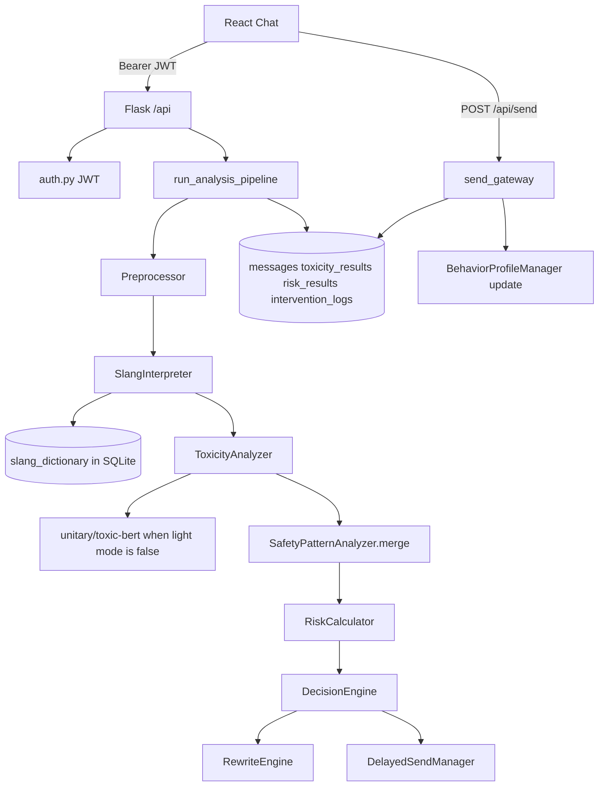

Historical record only. Light mode and lightweight model fallbacks have been removed. See README.md for the models the application loads now.

# PPTIS++ current implementation — technical audit

Audit date: 1 November 2026.  
Scope: the project at `pptis-plus-plus/` only. No other implementation was opened.  
Constraint: source, datasets, the database, checkpoints, and dependencies were not modified.

Verified facts come from reading the files and from commands that were actually run. Anything not executed is marked unverified.

## 1. Executive summary

The running application is a Flask REST backend plus a Vite/React frontend. A typed message is authenticated, preprocessed, passed through a slang interpreter, scored by `unitary/toxic-bert` when `PPTIS_LIGHT_MODE` is false, then overwritten by a regex safety layer, then turned into PACL, CEL, escalation probability, and final risk `R`. The Decision Engine maps `R` to ALLOW, WARN, REWRITE, or DELAYED-SEND. There is no BLOCK decision in this code.

The classification failure observed for “I will gntly stab you” (ALLOW, risk 0.25) is reproduced. Toxic-BERT assigned threat **0.8676** and toxic **0.8944**. The safety layer did not recognise “stab”, labelled the sentence ALLOW, and `SafetyPatternAnalyzer.merge` replaced the six-dimensional vector with zeros. With a zero toxic score, `Pesc = sigmoid(0) = 0.5` and `R = 0.25`.

A second, independent failure is in slang integration. The CSV has 36 rows (35 unique terms). The SQLite table the interpreter actually reads has 16 rows and **8 unique terms**. With the XLM-RoBERTa encoder loaded, prototype disambiguation returns `P(slang) ≈ 0.50`, which is below the 0.70 threshold, so meanings are not appended to the model input.

77 backend unit tests passed. They run with light mode forced on and do not execute Toxic-BERT. Test success is not classification accuracy.

## 2. Directory structure

Application root: `/Users/thanvithmk/Documents/MP_Lastest/pptis-plus-plus`.

```
pptis-plus-plus/
  README.md                         empty
  API_DOCUMENTATION.md
  DEPLOYMENT.md
  .env                              flags only; secrets not recorded here
  backend/
    app.py                          Flask factory
    config.py
    .env  .env.example
    api/__init__.py                 empty
    api/routes.py                   all /api routes
    api/schemas.py                  empty
    modules/                        pipeline modules listed below
    tests/                          unittest modules plus audit dataset
  frontend/
    package.json  vite.config.js  tailwind.config.js  postcss.config.js
    SETUP.md
    src/App.jsx  main.jsx  index.css
    src/components/  src/services/api.js  src/utils/time.js
  database/
    schema.sql  init_db.py  init_db.sql (empty)  migrate.py
    slang_dictionary.csv  pptis.db
  docs/                             earlier QA notes, not executed as part of this audit
```

There is no `requirements.txt`. Frontend dependencies are in `frontend/package.json`.

Empty or placeholder files: `README.md`, `backend/api/__init__.py`, `backend/api/schemas.py`, `backend/modules/__init__.py`, `database/init_db.sql`.

## 3. File-by-file documentation

### Backend entry and configuration

| Path | Role | Used at runtime |
|---|---|---|
| `backend/app.py` | `create_app`: logging, CORS, `init_db`, blueprints `/auth` and `/api`, error handlers | Yes. `python app.py` |
| `backend/config.py` | `Config`, `DevelopmentConfig`, `ProductionConfig`, `TestingConfig`. Fixed `PACL_LAMBDA=0.5`, `FINAL_RISK_ALPHA=0.5`, thresholds 0.30 / 0.55 / 0.80, `CEL_WEIGHT_VECTOR=(1,1,1,1,1,1)`, logistic defaults | Yes |
| `backend/api/routes.py` | HTTP API and `run_analysis_pipeline` | Yes |
| `backend/api/schemas.py` | Empty. No request schemas | No |

`app.py` imports: `dotenv`, `flask`, `flask_cors`, `config.get_config`, `modules.database.init_db`. Blueprints imported inside `register_blueprints`.

### Pipeline modules

| Path | Classes / functions | Input → output | Called by | Active |
|---|---|---|---|---|
| `modules/auth.py` | `register_user`, `login_user`, `logout_user`, `require_auth`, `auth_bp` | credentials → JWT user payload | `api/routes.py`, `app.py` | Yes |
| `modules/preprocessing.py` | `Preprocessor.preprocess`, `tokenize` | raw string → original, cleaned text, tokens, emoji list | `run_analysis_pipeline` | Yes |
| `modules/text_normalize.py` | `unfold_for_analysis` | leetspeak / emoji weapons → unfolded string | `safety_patterns.py` only | Yes, safety path only. Not applied to the BERT input |
| `modules/slang_layer.py` | `SlangInterpreter` | cleaned text → enriched string, unknown list | `run_analysis_pipeline` | Yes |
| `modules/safety_patterns.py` | `SafetyPatternAnalyzer.score`, `merge` | text + optional context → label and 6-D overlay | `toxicity_model.analyze` | Yes. This is the step that can erase model scores |
| `modules/toxicity_model.py` | `ToxicityAnalyzer.analyze` | text → 6-D dict | pipeline, rewrite, delayed-send | Yes |
| `modules/behavior_profile.py` | `BehaviorProfileManager` | user id + vector → six running averages | pipeline read; `send_gateway` write | Yes |
| `modules/risk_calculation.py` | `RiskCalculator` | Tb, BT, Xt, Xt-1 → PACL, E, Pesc, R | pipeline, decision, rewrite | Yes |
| `modules/decision_engine.py` | `DecisionEngine.make_decision`, `apply_decision` | R + vector → decision name and UI payload | pipeline | Yes |
| `modules/rewrite_engine.py` | `RewriteEngine.rewrite` | text + last 5 messages → suggestion or edit-only | pipeline when decision is REWRITE | Yes |
| `modules/delayed_send.py` | `DelayedSendManager` | message id → lock, countdown, exercises | pipeline and `/api/send` | Yes |
| `modules/send_gateway.py` | `send_analyzed_message` | message id + text + action → sent row or `SendError` | `POST /api/send` | Yes |
| `modules/ril.py` | `BehavioralLearning` | intervention outcome → `feedback` row and effectiveness | profile endpoint; WARN send | Partial. Does not choose the next decision |
| `modules/speech_to_text.py` | `VoiceTranscriber` | audio path → transcript dict | `POST /api/analyze-voice` only | Partial. Not loaded during text analyze |
| `modules/database.py` | SQLAlchemy models and `init_db` | URI → session | every module that persists | Yes |

### Frontend

| Path | Role | Active |
|---|---|---|
| `frontend/src/main.jsx` | `BrowserRouter` around `App` | Yes |
| `frontend/src/App.jsx` | Login/register form, session restore, chat and dashboard routes | Yes |
| `frontend/src/services/api.js` | Axios client, JWT in `localStorage` key `pptis_token` | Yes |
| `frontend/src/components/Chat.jsx` | Analyze, send, history, conversation switch | Yes |
| `frontend/src/components/TextInput.jsx` | Send and Analyze buttons | Yes |
| `frontend/src/components/VoiceInput.jsx` | `MediaRecorder` → `/api/analyze-voice` | Yes, if the browser grants the microphone |
| `frontend/src/components/AnalysisResults.jsx` | Six bars, PACL, Pesc, R, decision | Yes |
| `frontend/src/components/RiskScore.jsx` | Renders the numeric risk | Yes |
| `frontend/src/components/InterventionModal.jsx` | WARN / REWRITE / DELAYED-SEND UI | Yes |
| `frontend/src/components/BehaviorDashboard.jsx` | Charts from `/api/dashboard` | Yes |
| `frontend/src/utils/time.js` | `formatClock` → `HH:MM` | Yes |

### Database and tests

| Path | Role | Active |
|---|---|---|
| `database/schema.sql` | PostgreSQL DDL | Used by `init_db.py` / migrate, not by the Flask request path directly |
| `database/init_db.py` | Creates tables and loads the CSV into `slang_dictionary` | Manual script |
| `database/migrate.py` | Additive column migration | Manual script |
| `database/pptis.db` | Live SQLite file named by `SQLITE_PATH` | Yes, while `USE_POSTGRES=false` |
| `backend/tests/test_*.py` | Unit and HTTP policy tests | Test-only. Light mode |
| `backend/tests/audit_dataset.py` | 265 labelled sentences | Used by `audit_runner.py`, not by the API |
| `backend/tests/audit_runner.py` | Offline accuracy harness | Test-only. Forces light mode |

## 4. Actual architecture



Status of each layer:

| Layer | Status |
|---|---|
| Auth, conversations, text analyze, send policy | Fully implemented |
| Preprocess | Implemented. Preserves emoji and contractions. Replaces URLs, mentions, hashtags |
| Slang CSV → database | Partial. CSV is not read during inference. Live table is a subset and contains duplicates |
| Slang disambiguation | Partial. XLM-R encoder exists. Head is untrained. Scores sit on 0.50 and fail the 0.70 gate |
| Toxic-BERT | Implemented when light mode is false. Sigmoid, six labels, correct names |
| Safety overlay | Implemented and currently able to zero a high BERT threat score |
| PACL, CEL, Pesc, R | Implemented with fixed λ and α. Logistic weights are defaults, not a fitted model |
| Decision | Implemented as four bands plus an escalate-only guardrail on the post-merge vector |
| Rewrite | Implemented. Groq if `GROQ_API_KEY` is set; otherwise a template. Key is empty |
| Delayed-send | Implemented. Name is DELAYED-SEND, not BLOCK |
| Voice / Whisper | Code exists. `faster-whisper` is not installed in this interpreter. Not reached by text analyze |
| RIL | Stores feedback. Does not change the decision or α/λ |
| Dashboard | Reads stored rows for the logged-in user |
| `api/schemas.py`, `init_db.sql`, `README.md` | Empty placeholders |

## 5. Message execution pipeline

Real order inside `run_analysis_pipeline` (`backend/api/routes.py`):

1. `require_auth` sets `g.current_user_id` from the Bearer access token.
2. Body field `text` or `original_text` is required. `input_type` must be `text` or `voice`.
3. `_get_or_create_conversation` checks ownership or inserts a conversation.
4. `_recent_message_texts` loads up to four prior message strings. This string is **context for the safety layer only**. It is not prepended to the BERT input.
5. `Preprocessor.preprocess(text)` → `cleaned_text`.
6. `SlangInterpreter.interpret(cleaned)` → `enriched_text_with_context`.
7. `ToxicityAnalyzer.analyze(enriched, context=prior_context)`.
   - Cache lookup.
   - If light mode or the model failed to load: lexicon counts, then `safety.merge`.
   - Else: `AutoModelForSequenceClassification` forward, sigmoid, map `id2label`, then `safety.merge`.
8. The returned vector is what is stored. BERT’s raw vector is not stored separately.
9. Insert `Message` (original, current, analyzed, processed/enriched, `send_status=draft`).
10. `_previous_toxicity` loads the previous message’s stored vector in the same conversation, newest first.
11. `get_or_create_profile` then `get_profile` for baseline `BT`. The profile is **not** updated here.
12. `calculate_pacl(vector[0], baseline[0])` using only the toxic dimension.
13. If no previous vector, `ΔX = 0` and `E = 0`. Else `ΔX = Xt - Xt-1`, `E = W · ΔX`.
14. `calculate_escalation_probability(E, PACL)`.
15. `calculate_final_risk(PACL, Pesc)`.
16. `make_decision(R, toxicity_vector=stored_vector)`.
17. Insert `RiskResult`.
18. `apply_decision`. If REWRITE, `RewriteEngine.rewrite` loads five earlier messages. If DELAYED-SEND, `create_delayed_send_state`.
19. Insert `InterventionLog`.
20. JSON response includes `toxicity`, `pacl`, `escalation_probability`, `final_risk`, `risk_score` (same number), `decision`, `slang`, `rewrite`, `delayed_send`.

Send is a second request, `POST /api/send`. It refuses edited text, missing analysis, REWRITE, an active delay lock, and WARN unless `user_action` is `send_anyway`. On success it sets `send_status=sent` and then updates the behaviour profile.

Frontend: `Chat.runAnalyze` → `analyzeText` → paints `result.decision` and `result.risk_score` or `result.final_risk`. It does not recompute R. A missing number is shown as “Risk score unavailable”. Axios timeout is 60 seconds (`frontend/src/services/api.js`).

## 6. Slang dataset

### CSV

| Property | Verified value |
|---|---|
| Path | `database/slang_dictionary.csv` |
| Size | 1361 bytes |
| Encoding | UTF-8, no BOM |
| Delimiter | comma, `csv.DictReader` |
| Columns | `slang_term`, `meaning`, `category`, `confidence` |
| Rows | 36 |
| Unique terms | 35 |
| Duplicate | `slay` appears twice, meanings “do extremely well” and “succeed stylishly” |
| Empty term or meaning | 0 |
| Non-ASCII terms | 0 |

First row: `cooked`, `defeated/finished/in serious trouble`, `gen-z`, `0.95`.

### What inference actually loads

`SlangInterpreter._load_slang_dictionary` queries SQLAlchemy `SlangDictionary`. It does not open the CSV. Exceptions are logged and the in-memory dictionary becomes empty.

`database/init_db.py` function `load_slang_dictionary` is the CSV loader. It inserts every CSV row. `slang_term` is not unique in `schema.sql`, so a second init duplicates rows.

Live database `database/pptis.db`, table `slang_dictionary`:

- 16 rows.
- 8 unique terms, each stored twice: `bet`, `bussin`, `cap`, `cooked`, `mid`, `no cap`, `rizz`, `slay`.
- In-memory dictionary after load: **8 terms** (`SLANG_LOADED 8` in the probe).

Terms present in the CSV and absent from this database include `dead`, `fire`, `sick`, `lowkey`, `highkey`, `extra`, `cringe`, `clown`, `salty`, `pressed`, `delulu`, `sus`, `npc`, `ate`, `touch grass`, `it's giving`, `noob`, `gg`, `W`, `L`, `cooked beyond repair`, `fr`, `ngl`, `macha`, `timepass`, `scene illa`, `bakwas`.

`SLANG_CSV_PATH` is set in `.env`. The request path ignores it.

### Detection algorithm

`detect_candidates` lowercases the text and searches each dictionary key with `str.find`, longest term first. A hit must be a whole token (`_is_whole_term` uses `[A-Za-z0-9']`) and must not overlap an earlier hit. This is case-insensitive token matching, not fuzzy matching. Misspellings, repeated characters, and unknown words are not detected. Emojis do not break a neighbouring Latin token.

Probe, encoder loaded:

| Text | Candidates |
|---|---|
| `The chicken is cooked.` | `cooked` at index 15 |
| `Bro you're cooked 💀` | `cooked` at index 11 |
| `no cap that was mid` | `no cap` at 0, `mid` at 16 |

### Disambiguation

Threshold: `SLANG_THRESHOLD` default **0.7** (`slang_layer.py`).

If `PPTIS_LIGHT_MODE` is true, `encoder` stays `None` and `_heuristic_scores` counts cue words (`bro`, `chicken`, `kitchen`, …). That path was not the one measured below.

If light mode is false, `xlm-roberta-base` encodes the sentence. `SLANG_CLASSIFIER_PATH` is unset, so `_load_classifier_weights` returns false. Scores come from `_prototype_scores`: max cosine against three slang prompt templates and three literal prompt templates, then softmax. The head `SlangLiteralHead` is created and not trained.

Measured prototype probabilities:

| Text | P(slang) | P(literal) | classification |
|---|---:|---:|---|
| The chicken is cooked. | 0.5006809234619141 | 0.4993191659450531 | slang |
| Bro you're cooked 💀 | 0.5002573132514954 | 0.499742716550827 | slang |
| no cap (in “no cap that was mid”) | 0.5000348091125488 | 0.4999651610851288 | slang |
| mid (same sentence) | 0.5000219345092773 | 0.49997812509536743 | slang |

`classification` is slang because `p_slang >= p_literal`, but `enrich_with_context` **skips the term when `p_slang <= 0.70`**. Both the chicken sentence and the “bro you’re cooked” sentence therefore produce no meaning annotation. The system does not separate those two contexts in the text that reaches Toxic-BERT.

### Enrichment

`interpret` does not return the candidate list. The API field `slang` is the enrich dict: `original_text`, `enriched_text_with_context`, `unknown_slang`.

Measured enriched strings were identical to the cleaned input for every probe sentence, including both cooked examples and “Bro is completely glorped.” Unknown “glorped” was not logged because it was never a dictionary candidate. `handle_unknown_slang` runs only when a detected term has no dictionary row.

## 7. Preprocessing

`Preprocessor.preprocess` (`backend/modules/preprocessing.py`):

| Operation | Happens | Before slang |
|---|---|---|
| Keep original string | Yes, returned as `original_text` | — |
| URL → `[URL]` | Yes | Yes |
| `@mention` → `[MENTION]` | Yes | Yes |
| `#tag` → `[HASHTAG]` | Yes | Yes |
| Collapse whitespace | Yes | Yes |
| Lowercasing | No | — |
| Emoji deletion | No | — |
| Contraction expansion | No. The `CONTRACTIONS` map is stored and reported, not applied to `cleaned_text` | — |
| Stop-word removal | No | — |
| Repeated-character folding | No. That is only in `unfold_for_analysis`, used by safety patterns | After, and not on the BERT string |
| Tokenization | Yes, returned separately. Slang detection uses the cleaned string, not the token list | Yes |

Measured:

| Input | cleaned_text | tokens |
|---|---|---|
| Thanks for reviewing the notes. | same | Thanks, for, reviewing, the, notes, . |
| You are stupid. | same | You, are, stupid, . |
| I will gntly stab you | same | I, will, gntly, stab, you |
| Bro you're cooked 💀 | same, emoji kept | Bro, you're, cooked, 💀 |
| k1ll you | `k1ll you` still has the digit | k1ll, you |

`unfold_for_analysis("k1ll you")` returns `kill you`. BERT is given `k1ll you`, so its threat score stays near zero (measured 0.0010). The safety layer sees the unfolded `kill you` and forces DELAYED-SEND.

## 8. Toxicity model

| Item | Verified value |
|---|---|
| Identifier | `unitary/toxic-bert` (`PRIMARY_MODEL`) |
| Class | `AutoModelForSequenceClassification` |
| Tokenizer | `AutoTokenizer.from_pretrained` of the same id |
| Task | `problem_type = multi_label_classification` |
| Labels | 6. `id2label`: 0 toxic, 1 severe_toxic, 2 obscene, 3 threat, 4 insult, 5 identity_hate |
| Activation | `torch.sigmoid` because `multilabel` is set true |
| Max length | `TOXICITY_MAX_LENGTH` default 512, truncation and padding on |
| Device | CUDA if available, else CPU. This machine used the default CPU path |
| Cache | in-process `OrderedDict`, key is SHA-256 of context plus text, size default 256 |
| Fallback | `nlptown/bert-base-multilingual-uncased-sentiment` only if Toxic-BERT fails to load. That checkpoint is not in the local Hugging Face cache. If it were used, `_vector_from_probs` would **not** read six toxicity heads; it would copy one softmax component into all six fields with fixed multipliers |
| Light mode | `PPTIS_LIGHT_MODE` default in code is true. Both `.env` files set it true. A process started as `PPTIS_LIGHT_MODE=false python app.py` skips the lexicon and loads Toxic-BERT. `python-dotenv` does not override an already-set variable |

The checkpoint is a published multi-label toxicity model. This repository does not contain further fine-tuning code or a local training set for it.

Vector construction is `_score_texts` then `_vector_from_probs`: each logit index is mapped by `id2label` into `toxic`, `severe_toxic`, `obscene`, `threat`, `insult`, `identity_hate`, then reordered to `(toxic, threat, insult, severe_toxic, obscene, identity_hate)`. Scores are clamped to `[0, 1]`. They are not averaged and softmax is not used on this checkpoint.

The vector that leaves `analyze` is not that tensor. It is `safety.merge(...)["vector"]`.

```288:294:pptis-plus-plus/backend/modules/safety_patterns.py
    def merge(self, base_scores, text, context=""):
        result = self.score(text, context=context)
        ...
        if result.get("label") == "ALLOW":
            return {**result, "vector": dict(ZERO)}
```

`THREAT` in the same file lists hurt, kill, knife, gun, and similar phrases. It does not list stab or cut. “I will gently stab you” and “I will gntly stab you” both receive safety label ALLOW.

When the label is not ALLOW, merge takes `max(BERT, overlay)` per dimension. The DELAYED-SEND overlay is the constant vector toxic 0.72, threat 0.90, insult 0.25, severe_toxic 0.58, obscene 0.10, identity_hate 0.0.

## 9. Measured classification behaviour

Probe command used `PPTIS_LIGHT_MODE=false` and the same classes the API uses. These are local function outputs, not HTTP responses. No number below was copied from a previous report.

| Original | Cleaned / model input | Detected slang in output | Meaning appended | Checkpoint | Raw six scores T, H, I, S, O, IH | After merge | Safety label |
|---|---|---|---|---|---|---|---|
| Thanks for reviewing the notes. | unchanged | none | no | unitary/toxic-bert | 0.0005, 0.0001, 0.0002, 0.0001, 0.0002, 0.0001 | all 0 | ALLOW |
| You are stupid. | unchanged | none | no | unitary/toxic-bert | 0.9868, 0.0013, 0.9517, 0.0341, 0.7134, 0.0123 | same as raw | WARN |
| I will gntly stab you | unchanged | none | no | unitary/toxic-bert | 0.8944, 0.8676, 0.1128, 0.1106, 0.0857, 0.0502 | all 0 | ALLOW |
| I will gently stab you | unchanged | none | no | unitary/toxic-bert | 0.8695, 0.8506, 0.0912, 0.0864, 0.0660, 0.0414 | all 0 | ALLOW |
| The chicken is cooked. | unchanged | candidate found internally, dropped | no | unitary/toxic-bert | 0.0045, 0.0001, 0.0003, 0.0001, 0.0003, 0.0003 | all 0 | ALLOW |
| Bro you're cooked | unchanged | candidate found, dropped | no | unitary/toxic-bert | 0.2354, 0.0005, 0.0172, 0.0002, 0.0033, 0.0009 | all 0 | ALLOW |
| Bro you're cooked 💀 | unchanged | candidate found, dropped | no | unitary/toxic-bert | 0.2047, 0.0004, 0.0141, 0.0002, 0.0035, 0.0011 | all 0 | ALLOW |
| Bro is completely glorped. | unchanged | none | no | unitary/toxic-bert | 0.0062, 0.0001, 0.0004, 0.0001, 0.0005, 0.0002 | all 0 | ALLOW |
| k1ll you | model sees `k1ll you`; safety sees `kill you` | none | no | unitary/toxic-bert | 0.4653, 0.0010, 0.0189, 0.0008, 0.0379, 0.0015 | 0.72, 0.90, 0.25, 0.58, 0.10, 0.0015 | DELAYED-SEND |

Order of the six numbers is toxic, threat, insult, severe_toxic, obscene, identity_hate.

Derived from the formulas with the merged vector, assuming baseline toxic `BT = 0` and `E = 0` (first message). This derivation was not re-read from the UI except where noted:

- Zero vector: `PACL = 0`, `Pesc = 1/(1+e^0) = 0.5`, `R = 0.5*0 + 0.5*0.5 = 0.25`. Decision band is ALLOW because `0.25 < 0.30`. This matches the UI report for “I will gntly stab you”.
- “You are stupid.” keeps toxic 0.9868. `PACL = clip(0.9868 + 0.5*0.9868, 0, 1) = 1`. `Pesc = sigmoid(1) ≈ 0.731`. `R ≈ 0.866`, which is in the DELAYED-SEND band even though the safety label was only WARN. Not confirmed through HTTP in this audit.

Failure split:

| Area | Finding |
|---|---|
| A. Input | The stab sentence reaches the model intact, including the typo |
| B. Preprocess | Does not remove “stab”. Leetspeak is not unfolded before BERT |
| C. Slang | Encoder scores never clear 0.70, so enrichment does not change model input |
| D. Dataset | Inference sees 8 terms, not the 36-row CSV |
| E. Model load | Toxic-BERT did load in the probe. Light mode in `.env` is true, so a normal `python app.py` would not load it |
| F. Inference | The stab sentence is scored as a threat by the model |
| G. Label map | `id2label` order is correct. The loss happens after mapping |
| H. Threshold | Safety ALLOW short-circuits to a zero vector. There is no per-label BERT threshold |
| I. Risk | A zero toxic score produces R = 0.25, which is ALLOW |

## 10. Custom intelligence

### Toxicity profile

`Xt` stored in `toxicity_results`: six float columns, each checked to be in `[0, 1]`. The stored row is the post-merge vector.

### Behavioural profile

`BehaviorProfileManager` keeps six running means and `message_count`, one row per `user_id`. A missing profile is created at zeros. `get_profile` returns that vector. Update formula: `new = (n * old + x) / (n + 1)` on each dimension. Update runs from `send_gateway` after a successful send, not from analyze. Users do not share rows. A first message therefore always sees `BT = 0` even if the user has unsent drafts.

### PACL

```165:167:pptis-plus-plus/backend/modules/risk_calculation.py
        # PACL = clip[Tb + λ(Tb - B_T), 0, 1]
        raw = tb + lam * (tb - baseline)
        pacl = min(1.0, max(0.0, raw))
```

`Tb` is `vector[0]`, the toxic component only. `λ` is `config.PACL_LAMBDA`, hardcoded `0.5`. RIL does not write it.

### CEL

`calculate_delta_x` subtracts two length-6 lists. `calculate_cel` is the dot product with `CEL_WEIGHT_VECTOR`, all ones. All six dimensions are included. If there is no previous toxicity row, both delta and `E` are zeros. Weights are constants, not loaded from a training artifact.

### Escalation

```240:242:pptis-plus-plus/backend/modules/risk_calculation.py
        # P_esc = 1 / (1 + e^(-z)), z = b + w_E * E + w_P * PACL
        z_score = intercept + weight_e * e_score + weight_p * pacl
        probability = self._sigmoid(z_score)
```

`LOGISTIC_B`, `LOGISTIC_W_E`, `LOGISTIC_W_P` default to 0, 1, and 1. They are not set in the project `.env`, so those defaults apply. `train_escalation_model` exists and is not called by the request path. `load_escalation_parameters` may replace them if a saved file exists; no such file was part of this audit’s execution, and the probe was not needed to see the defaults in `config.py`.

### Final risk

```196:197:pptis-plus-plus/backend/modules/risk_calculation.py
        # R = α * PACL + (1 - α) * P_esc
        final_risk = min(1.0, max(0.0, weight * pacl + (1.0 - weight) * p_esc))
```

`α` is `FINAL_RISK_ALPHA = 0.5`.

### Decision engine

```51:59:pptis-plus-plus/backend/modules/decision_engine.py
        if score < self.T_allow:
            decision = "ALLOW"
        elif score < self.T_warn:
            decision = "WARN"
        elif score < self.T_rewrite:
            decision = "REWRITE"
        else:
            decision = "DELAYED-SEND"
```

Thresholds: 0.30, 0.55, 0.80. The string is `DELAYED-SEND`. There is no `BLOCK` branch.

`_apply_safety_guardrail` can raise the decision to DELAYED-SEND when the **post-merge** threat is at least 0.75, severe_toxic at least 0.70, or identity_hate at least 0.70, unless the safety flags say quoted, negated, or playful. It does not change `R`. On the stab sentence the post-merge threat is 0, so the guardrail does not fire. On `k1ll you` the overlay threat is 0.90, so the guardrail would also force DELAYED-SEND.

## 11. Database

Technology in the checked environment: SQLite, because both `.env` files set `USE_POSTGRES` false and `SQLITE_PATH` to `database/pptis.db`. `config.py` can build a PostgreSQL URI when `USE_POSTGRES` is true or `DATABASE_URL` is set. That path was not connected during this audit.

`schema.sql` defines PostgreSQL enums and tables: `users`, `conversations`, `messages`, `toxicity_results`, `behavior_profiles`, `risk_results`, `intervention_logs`, `slang_dictionary`, `unknown_slang`, `feedback`, plus indexes. SQLAlchemy adds columns through `ensure_optional_columns`: message `current_text`, `analyzed_text`, `send_status`, `sent_at`, `analyzed_at`; intervention `user_action`; delayed-lock `conversation_id`. `RewriteEngine` creates `rewrite_context`. `DelayedSendManager` creates `delayed_send_locks`. `BehavioralLearning` creates `intervention_effectiveness`.

Relationships: conversations and messages belong to `user_id`. Toxicity, risk, interventions, and feedback reference `message_id`. `slang_term` has an index and no unique constraint.

Transactions: route code commits per stage and calls `session.rollback()` on failure, then `close_session()` (`Session.remove()`). A failure after the message insert but before the risk insert can leave a draft without a decision. That sequence was not forced in this audit.

Slang rows used by classification are the SQLite rows described in section 6, not the CSV.

## 12. API

All JSON routes below live under `/api` unless noted. `/auth/*` duplicates register, login, logout, refresh, and password reset.

| Method and path | Auth | Calls | Persistence |
|---|---|---|---|
| POST `/api/auth/register` | No | `register_user` | `users` |
| POST `/api/auth/login` | No | `login_user` | read `users` |
| POST `/api/auth/logout` | Yes | `logout_user` | in-memory JWT blacklist only |
| POST `/api/analyze` | Yes | `run_analysis_pipeline` | message, toxicity, risk, intervention |
| POST `/api/analyze-voice` | Yes | `VoiceTranscriber` then the same pipeline | same, after a transcript exists |
| POST `/api/send` | Yes | `send_analyzed_message` | send status, intervention, profile, optional feedback |
| GET `/api/delayed-send/<id>` | Yes | lock status after ownership check | read |
| GET `/api/user/profile` | Yes | profile, baseline, RIL insights | read |
| GET `/api/dashboard` | Yes | counts and averages for that user | read |
| GET `/api/conversations` | Yes | list owned conversations | read |
| POST `/api/conversations` | Yes | create conversation | insert |
| GET `/api/conversation/<id>` | Yes | messages, latest toxicity, latest risk | read. 403 if not owner |

Analyze request from the frontend is `{text, conversation_id?}`. The backend also accepts `original_text`, `input_type`, and `transcription_confidence`. Response decision is a string. Frontend reads `decision`, `risk_score`, `final_risk`, `message_id`, `conversation_id`, `suggested_text`, `delayed_send`.

Unauthenticated analyze returns 401. That was covered by `tests.test_e2e_application` in the test run below, against an in-memory database, not against `pptis.db`.

## 13. Frontend

React 18, React Router 6, Axios, Tailwind, Recharts. No global store beyond component state and `localStorage`.

`App.jsx` restores the session with `GET /api/user/profile`. Login and register post to `/api/auth/*` and store `data.token`. Logout posts `/api/auth/logout` and clears the token.

`AnalysisResults` prints `toxicity.toxic` through `toxicity.identity_hate` with two decimal places, plus PACL, escalation probability, and final risk from the response. It does not derive a different decision. `Chat.jsx` shows the same decision and risk on the bubble.

WARN offers Edit, Cancel, and Send Anyway (`user_action=send_anyway`). REWRITE offers Use Suggested Rewrite (which calls analyze again) and Edit. There is no send-original button. DELAYED-SEND shows a countdown and four exercises and disables send while the flow state is `DELAYED_SEND`.

Voice sets the bubble text from `result.original_text`, then `result.transcription.text`. A transcription failure never enters the toxicity pipeline.

## 14. Environment and dependencies

| Item | Value |
|---|---|
| Python | 3.11.8 |
| Node | v25.2.1 |
| requirements.txt | absent |
| Flask | 3.1.1 |
| Flask-CORS | 6.0.2 |
| Torch | 2.9.1 |
| Transformers | 4.57.3 |
| SQLAlchemy | 2.0.42 |
| scikit-learn | 1.5.2 |
| python-dotenv | 1.0.1 |
| PyJWT | 2.12.1 |
| NumPy | 1.26.4 |
| groq | 0.37.1 |
| Werkzeug | 3.1.3 |
| faster-whisper | not installed in this interpreter |

Frontend: React 18.3.1, react-router-dom 6.28.0, axios 1.7.7, recharts 2.13.3, Vite 5.4.11, Tailwind 3.4.15.

Startup that loads the transformer: from `backend/`, `PPTIS_LIGHT_MODE=false PYTHONPATH=. python app.py`. Without the env override, `.env` sets light mode true and Toxic-BERT is not loaded. Frontend: `npm run dev` in `frontend/` (Vite, port 3000 in the project docs).

Cached weights observed under `~/.cache/huggingface/hub`: `unitary/toxic-bert` 438 MB and `xlm-roberta-base` 1115.6 MB. No incomplete download files. No Whisper files. No `nlptown` sentiment checkpoint.

Environment names that are set, without values: `FLASK_ENV`, `PPTIS_LIGHT_MODE` (true in both `.env` files), `FLASK_APP`, `HOST`, `PORT`, `SECRET_KEY`, `JWT_SECRET_KEY`, `JWT_ACCESS_TOKEN_EXPIRES`, `CORS_ORIGINS`, `USE_POSTGRES` (false), `SQLITE_PATH`, Postgres host/port/db/user, `SLANG_CSV_PATH`, `WHISPER_MODEL`. `GROQ_API_KEY` and `POSTGRES_PASSWORD` are empty. `LOGISTIC_*` are not in `.env`, so config defaults apply.

`speech_to_text.py` imports `faster_whisper` at import time. The first voice request will fail import until that package exists. This audit did not install it.

## 15. Tests

Command: `PPTIS_LIGHT_MODE=true PYTHONPATH=. python -m unittest discover -s tests -q` from `backend/`.

Result: **Ran 77 tests in 4.283s. OK.** No failures.

| Module | What it checks | Transformer? |
|---|---|---|
| `test_modules.py` | auth, preprocess, slang candidate on “cooked” in light mode, lexicon toxicity, PACL/CEL math, decision boundaries, rewrite mock, delayed-send | No |
| `test_risk_calculation.py` | formula examples | No |
| `test_preprocessing.py` | emoji and contractions kept | No |
| `test_safety_patterns.py` | regex threats and a 50-row sheet, via light-mode `ToxicityAnalyzer` | No |
| `test_send_policy.py` | HTTP allow/warn/rewrite/delay/edit | Light-mode stack |
| `test_e2e_application.py` | register, send, cross-user 403, dashboard, logout | Light-mode stack |
| `test_integration.py` | seeded rows and a mocked pipeline | Mocked |
| `audit_runner.py` | not part of discover’s assertions unless imported by a test | Light mode |

`test_modules.py` calls `SlangInterpreter` and expects a “cooked” hit. That passes only if the test database seed includes the term. It does not assert XLM-R probabilities or Toxic-BERT scores.

## 16. Internal consistency

| Topic | What the code does |
|---|---|
| Decision name | DELAYED-SEND. Docs and some UI copy say delayed send. There is no BLOCK |
| Light mode | `.env` true versus a shell override false. Same source, different model |
| Slang source | CSV 36 rows versus SQLite 8 unique terms. Runtime uses SQLite |
| Slang threshold | Prototype scores are about 0.50 and the gate is 0.70, so enrichment does not run while the encoder is on |
| BERT versus regex | High threat from BERT is discarded when the regex returns ALLOW |
| Unfold versus BERT | `k1ll` is normalised for regex and not for BERT |
| Profile timing | Baseline used at analyze time excludes the current message and excludes unsent drafts |
| RIL | `LOGISTIC_COEFFICIENTS` in config is six zeros and is not the `b, wE, wP` triple actually used |
| Duplicate routes | `/auth/*` and `/api/auth/*` |
| Empty files | `schemas.py`, `README.md`, `init_db.sql` |
| Guardrail | Can disagree with the R band, but only using the post-merge vector |

## 17. Classification failure points

1. `merge` returns a zero vector for every safety ALLOW, which deletes a correct Toxic-BERT threat score. This is the direct cause of ALLOW / 0.25 on “I will gntly stab you”.
2. The threat regex does not include stab or cut, and it does not read the BERT threat score.
3. Default light mode never calls Toxic-BERT.
4. Only 8 slang terms are visible, and encoder disambiguation does not pass the 0.70 threshold, so slang context is not added to the model input.
5. Obfuscation such as `k1ll` is repaired for the regex and not for BERT, so the two components disagree.
6. PACL uses only `toxic`. A non-threat insult with toxic near 1 and a zero baseline can cross 0.80 and become DELAYED-SEND. Computed for “You are stupid.”, not confirmed over HTTP.
7. `Pesc` is 0.5 whenever `E` and `PACL` are 0, so a harmless message is scored 0.25 rather than 0. It still falls in ALLOW.

## 18. Code references

Safety wipe:

```293:294:pptis-plus-plus/backend/modules/safety_patterns.py
        if result.get("label") == "ALLOW":
            return {**result, "vector": dict(ZERO)}
```

BERT sigmoid and label map:

```220:236:pptis-plus-plus/backend/modules/toxicity_model.py
        with torch.no_grad():
            logits = self.model(**encoded).logits
            if self.multilabel:
                probs = torch.sigmoid(logits)
            else:
                probs = F.softmax(logits, dim=-1)
        return [self._vector_from_probs(row) for row in probs]
```

Enrichment gate:

```221:223:pptis-plus-plus/backend/modules/slang_layer.py
                verdict = self.disambiguate_slang_literal(term, context)
                if verdict["p_slang"] <= self.threshold:
                    continue
```

## 19. Limitations

- PostgreSQL was not connected. Schema compatibility with the live SQLite file was not diffed column by column.
- The HTTP response for the stab sentence was not reissued during this audit. The 0.25 figure is the formula applied to the measured zero vector, and it matches the UI value the user reported.
- Whisper and Groq were not called.
- `load_escalation_parameters` was not executed, so an on-disk override of `b`, `wE`, and `wP` is unverified. Config defaults are 0, 1, and 1.
- A long-message truncation case was not run. The tokenizer is configured with `max_length` 512.
- Unit tests do not measure Toxic-BERT.

## 20. Unverified assumptions

- That the Flask process still running in the user’s terminal is the `PPTIS_LIGHT_MODE=false` process. The `.env` value is true. The local probe that produced the tables above set false explicitly.
- That no saved logistic parameter file is loaded in that server process.
- That `unknown_slang` stays empty for “glorped” on the live API. The probe did not pass a `user_id`, and the term was not a candidate anyway.
